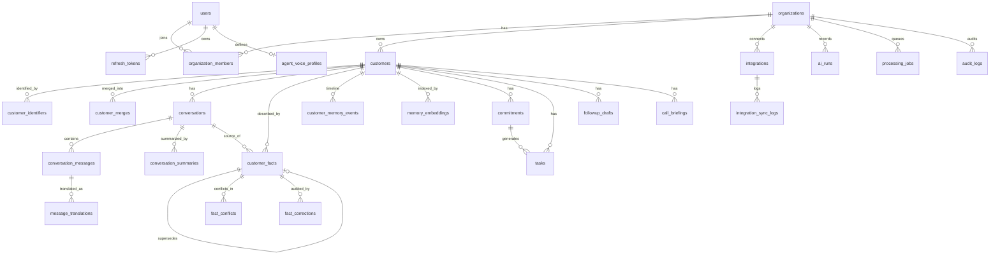

# DATABASE.md — REIA Database Design

Status: Draft v0.1 (Phase 0.1), pending review.
Supersedes the 20-table sketch in URD §10. Changes are listed in §10.

## 1. Principles

1. PostgreSQL is the source of truth. Embeddings are derived data and can be rebuilt at any time.
2. Original conversation content is immutable.
3. Facts are versioned, never overwritten. History is preserved.
4. Every AI-derived row carries provenance: source conversation, source message, evidence quote, and the AI run that produced it.
5. Tenant isolation is enforced in three layers: application repositories, composite foreign keys, and Row-Level Security (RLS).
6. No market assumptions are hardcoded. Currency, unit, language and country are data.
7. All timestamps are `timestamptz` and stored in UTC.
8. Enumerations use `text` plus `CHECK` constraints, not PostgreSQL enum types (easier to migrate).
9. Logs and audit rows never contain message bodies or other raw PII.

## 2. Conventions

- Primary keys: `uuid DEFAULT gen_random_uuid()`.
- Every table has `created_at timestamptz NOT NULL DEFAULT now()`. Mutable tables also have `updated_at`, maintained by the ORM.
- Table and column names are snake_case. Table names are plural.
- Tenant-owned tables have `organization_id uuid NOT NULL REFERENCES organizations(id)`.
- Every tenant-owned parent table declares `UNIQUE (organization_id, id)`. Child tables reference it with a composite FK `(organization_id, parent_id)`, so a child can never point to a parent in another tenant.
- Money: `numeric(18,2)` amount plus a separate ISO 4217 currency code. Never `float`.
- Area: numeric value plus an explicit unit (`sqm` or `sqft`).
- Languages: BCP 47 codes (`en`, `es`, `pt`, `pt-PT`). Countries: ISO 3166-1 alpha-2 (`AE`, `ES`, `PT`).
- Extensions: `citext`, `pg_trgm`, `unaccent`, `vector` (pgvector).

## 3. Entity relationship overview



## 4. Tenant isolation

### 4.1 Database roles

- `reia_migrator`: owns all tables, runs Alembic migrations. Never used by the running application.
- `reia_app`: used by FastAPI. `NOSUPERUSER NOBYPASSRLS`. Not the table owner. Has only the privileges listed in §7.

### 4.2 Row-Level Security

Applied to every tenant-owned table.

```sql
ALTER TABLE customers ENABLE ROW LEVEL SECURITY;
ALTER TABLE customers FORCE ROW LEVEL SECURITY;

CREATE POLICY tenant_isolation ON customers
  USING      (organization_id = NULLIF(current_setting('app.current_org_id', true), '')::uuid)
  WITH CHECK (organization_id = NULLIF(current_setting('app.current_org_id', true), '')::uuid);
```

If `app.current_org_id` is not set, the policy evaluates to NULL and the query returns no rows. The system fails closed.

### 4.3 Setting the tenant per transaction

The application sets the tenant at the start of every request transaction, after authentication:

```sql
SELECT set_config('app.current_org_id', :org_id, true);  -- true = transaction-local
```

`set_config` accepts bound parameters (plain `SET LOCAL` does not). The setting is transaction-local, so it is safe with connection pooling. Application-layer repositories still filter by `organization_id` explicitly. RLS is a second layer, not a replacement.

### 4.4 Tables that are not tenant-owned

`users`, `refresh_tokens` and `one_time_tokens` are global. A user can belong to several organizations through `organization_members`. Access to them goes through authenticated code paths only.

## 5. Tables

Notation: `*` = NOT NULL. Every tenant-owned table also has `organization_id*` as described in §2.

### 5.1 Identity and tenancy

**organizations**
- id*, name*, plan* (default `'pilot'`)
- country* (ISO alpha-2), default_locale* (default `'en'`), default_currency* (ISO 4217), timezone* (IANA, e.g. `Europe/Madrid`)
- settings* jsonb default `'{}'` (country-config overrides, validated by Pydantic)
- created_at*, updated_at*, deleted_at

**users**
- id*, email* (`citext`, unique), password_hash (nullable when external auth is used), full_name*
- ui_language* (default `'en'`), status* (`active`, `suspended`, `deleted`)
- email_verified_at, last_login_at, platform_role (nullable, `platform_admin` only)
- created_at*, updated_at*

**organization_members**
- id*, organization_id*, user_id*
- role* (`owner`, `admin`, `agent`, `read_only`), status* (`active`, `invited`, `suspended`)
- UNIQUE (organization_id, user_id)

**refresh_tokens** (supports rotation and reuse detection)
- id*, user_id*, organization_id, token_hash* (SHA-256, never the raw token), family_id*
- expires_at*, revoked_at, replaced_by_id, user_agent, ip_address (inet)

**one_time_tokens** (email verification, password reset)
- id*, user_id*, purpose* (`email_verify`, `password_reset`), token_hash*, expires_at*, used_at

### 5.2 Customers and identity resolution

**customers**
- id*, organization_id*, assigned_user_id (FK to users)
- full_name*, customer_type* (`buyer`, `seller`, `tenant`, `landlord`, `investor`, `other`)
- status* (`new_lead`, `contacted`, `qualified`, `active_conversation`, `viewing_scheduled`, `negotiation`, `converted`, `lost`, `dormant`)
- preferred_language (BCP 47), country (ISO alpha-2)
- merged_into_customer_id (composite FK to customers), created_by*
- created_at*, updated_at*, deleted_at
- UNIQUE (organization_id, id)

**customer_identifiers**
- id*, organization_id*, customer_id*
- identifier_type* (`email`, `phone`, `whatsapp`, `crm_id`)
- value_raw* (as received), value_normalized* (lowercased email, E.164 phone)
- is_primary* (default false), source* (`manual`, `import`, `integration`), removed_at
- Partial UNIQUE (organization_id, identifier_type, value_normalized) WHERE removed_at IS NULL. One active identifier belongs to one customer. When a new customer collides, the service returns a "possible duplicate" response and the agent decides. Nothing is merged automatically.

**customer_merges**
- id*, organization_id*, source_customer_id*, target_customer_id*
- performed_by*, reason, snapshot* jsonb (pre-merge state of the source), created_at*

### 5.3 Conversations

**conversations**
- id*, organization_id*, customer_id (nullable until matched; composite FK)
- channel* (`whatsapp`, `email`, `call_note`, `meeting_note`, `sms`, `other`)
- direction* (`inbound`, `outbound`, `mixed`)
- source_identifier (external id), import_method* (`paste`, `txt`, `csv`, `manual_note`, `integration`)
- original_content* (immutable), original_language (BCP 47), detected_language
- content_hash* (SHA-256 of normalized content)
- occurred_at*, processing_status* (`pending_customer_match`, `pending`, `processing`, `processed`, `failed`)
- created_by*, created_at*
- UNIQUE (organization_id, id)
- UNIQUE (organization_id, content_hash). This is the duplicate-import guard (URD Test 7).
- Partial UNIQUE (organization_id, channel, source_identifier) WHERE source_identifier IS NOT NULL

**conversation_messages**
- id*, organization_id*, conversation_id* (composite FK), sequence_no*
- sender_label* (as written in the source), sender_role* (`agent`, `customer`, `system`, `unknown`)
- content*, language, occurred_at, metadata* jsonb default `'{}'`
- search_config* (`regconfig`, set by the application from the detected language, default `'simple'`)
- search_vector (`tsvector GENERATED ALWAYS AS (to_tsvector(search_config, content)) STORED`). Verify in the Phase 4 migration test.
- UNIQUE (conversation_id, sequence_no), UNIQUE (organization_id, id)

**message_translations** (translations never replace originals)
- id*, organization_id*, message_id* (composite FK), target_language*
- translated_content*, ai_run_id, created_at*
- UNIQUE (message_id, target_language)

**conversation_summaries**
- id*, organization_id*, conversation_id* (composite FK)
- summary*, summary_language*, ai_run_id, is_current* (default true), created_at*
- Reprocessing adds a new row and sets the old `is_current = false`.

### 5.4 Customer facts and memory

**customer_facts**
- id*, organization_id*, customer_id* (composite FK)
- category* (`identity`, `property_requirement`, `financial`, `intent`, `preference`, `objection`, `communication`)
- fact_key* (canonical English snake_case, e.g. `budget`, `bedrooms`, `preferred_location`). The registry lives in code: `app/modules/memory/fact_keys.py`.
- slot_key* (default `''`). Multi-valued keys (e.g. several preferred locations) use one slot per value.
- value_type* (`text`, `money`, `area`, `integer`, `boolean`, `date`, `location`, `json`)
- value_text, numeric_min, numeric_max, unit_code (ISO 4217 currency or `sqm`/`sqft`), value_json
- source_conversation_id* and source_message_id (composite FKs), or manual note: see `origin`
- evidence_quote* (original language, verbatim), evidence_language
- confidence* `numeric(3,2)` (0 to 1), origin* (`ai_extracted`, `manual`)
- verification_status* (`unverified`, `verified`)
- lifecycle_status* (`current`, `superseded`, `expired`, `disputed`, `rejected`)
- valid_from* (the time the customer said it, i.e. the source conversation's `occurred_at`, not extraction time), valid_to
- supersedes_fact_id (self FK), created_by, ai_run_id, created_at*, updated_at*
- CHECKs:
  - `confidence BETWEEN 0 AND 1`
  - `value_type = 'money'` implies `unit_code ~ '^[A-Z]{3}$'` and `numeric_min IS NOT NULL`
  - `value_type = 'area'` implies `unit_code IN ('sqm','sqft')` and `numeric_min IS NOT NULL`
  - `numeric_max IS NULL OR numeric_max >= numeric_min`
  - `origin = 'ai_extracted'` implies `source_conversation_id IS NOT NULL` and `evidence_quote` is not empty
- Partial UNIQUE (organization_id, customer_id, fact_key, slot_key) WHERE lifecycle_status = 'current'. Only one current value per slot. A budget change creates a new fact, marks the old one `superseded`, and links it through `supersedes_fact_id`.
- Conflicting statements with no explicit replacement are both stored as `disputed` and linked in `fact_conflicts`.

**fact_conflicts**
- id*, organization_id*, customer_id*, fact_key*, fact_a_id*, fact_b_id* (CHECK a <> b)
- status* (`open`, `resolved_a`, `resolved_b`, `both_valid`, `dismissed`)
- resolved_by, resolved_at, resolution_note, created_at*

**fact_corrections** (append-only audit of agent actions on facts)
- id*, organization_id*, fact_id*
- action* (`verify`, `reject`, `correct`, `restore`)
- previous_snapshot* jsonb, new_snapshot* jsonb, performed_by*, reason, created_at*
- A correction creates a new manual, verified fact that supersedes the old one. The original and its source stay available.

**customer_memory_events** (episodic memory, append-only)
- id*, organization_id*, customer_id*
- event_type* (`budget_changed`, `property_rejected`, `callback_requested`, `viewing_attended`, `status_changed`, `became_inactive`, `interest_expressed`, `decision_postponed`, `other`)
- description*, source_conversation_id, related_fact_id, occurred_at*, metadata*, created_at*

**memory_embeddings**
- id*, organization_id*, customer_id* (composite FK)
- source_type* (`message`, `summary`, `fact`, `note`), source_id*, chunk_index* (default 0)
- content*, content_language, content_hash*
- embedding* `vector(1536)` (dimension set by ADR-007), embedding_model*, embedding_dimension*
- UNIQUE (source_type, source_id, chunk_index, embedding_model)
- Embeddings of rejected facts and erased customers are deleted by a cleanup job.

### 5.5 Work management

**commitments**
- id*, organization_id*, customer_id*
- responsible_party* (`agent`, `customer`), description*, due_at
- status* (`suggested`, `open`, `fulfilled`, `cancelled`)
- origin* (`ai_extracted`, `manual`), source_conversation_id, source_message_id, evidence_quote
- created_at*, updated_at*
- AI-suggested commitments start as `suggested` and need agent approval.

**tasks**
- id*, organization_id*, customer_id*, assigned_user_id
- title*, description, category* (`call`, `send_details`, `arrange_viewing`, `request_documents`, `follow_up_offer`, `confirm_appointment`, `review_financing`, `respond`, `other`)
- priority* (`low`, `normal`, `high`, `urgent`), status* (`suggested`, `open`, `in_progress`, `done`, `cancelled`)
- due_at, completed_at, origin* (`ai_suggested`, `manual`)
- source_conversation_id, source_commitment_id, created_at*, updated_at*

**followup_drafts**
- id*, organization_id*, customer_id*, channel* (`whatsapp`, `email`, `sms`)
- language* (customer's preferred language), generated_content*, edited_content
- context_references* jsonb (ids of the facts and messages used)
- status* (`draft`, `edited`, `approved`, `sent_manually`, `discarded`)
- approved_at, sent_conversation_id, ai_run_id, created_by*, created_at*, updated_at*
- There is no send path in the MVP. `sent_manually` is set by the agent.

**call_briefings**
- id*, organization_id*, customer_id*, language*, content* jsonb (the 10 briefing sections)
- source_references* jsonb, ai_run_id, generated_by*, created_at*

**agent_voice_profiles**
- id*, organization_id*, user_id*, tone, formality, message_length
- preferred_languages* (`text[]`), style_preferences* jsonb, example_messages* jsonb, updated_at*
- UNIQUE (organization_id, user_id)

### 5.6 Operations, integrations and audit

**processing_jobs**
- id*, organization_id*, job_type* (`process_conversation`, `embed`, `reprocess`, `sync`)
- subject_type*, subject_id*, status* (`queued`, `running`, `succeeded`, `failed`, `dead`)
- attempts* (default 0), max_attempts* (default 3), idempotency_key*, last_error
- scheduled_at*, started_at, finished_at
- UNIQUE (organization_id, idempotency_key)

**ai_runs**
- id*, organization_id*, customer_id, job_id
- operation* (`extract`, `summarize`, `compare_facts`, `answer`, `draft`, `briefing`, `translate`, `embed`)
- provider*, model*, prompt_name*, prompt_version*, input_hash* (no raw prompt text by default)
- input_tokens, output_tokens, cost_usd `numeric(10,6)`, latency_ms
- status* (`succeeded`, `schema_invalid`, `provider_error`, `timeout`), error_code, error_details, created_at*

**integrations**
- id*, organization_id*, provider* (`pipedrive`, `whatsapp_business`, `gmail`, `outlook`)
- connection_status*, external_account_id
- credentials_encrypted (application-level encryption, key from the environment or secret manager; never plaintext)
- settings* jsonb, created_at*, updated_at*
- UNIQUE (organization_id, provider, external_account_id)

**integration_sync_logs**
- id*, organization_id*, integration_id*, operation*, status*, external_identifier, error_details, created_at*

**notifications**
- id*, organization_id*, user_id*, notification_type*, content* jsonb, status* (`unread`, `read`), created_at*

**consent_records** (supports GDPR and UAE PDPL lawful-processing evidence; scope finalized in PRIVACY.md)
- id*, organization_id*, customer_id*, purpose*, lawful_basis*, status* (`granted`, `withdrawn`, `not_required`)
- evidence_reference, recorded_by*, recorded_at*

**audit_logs** (append-only)
- id*, organization_id (null for platform-level events), user_id
- action*, resource_type*, resource_id, ip_address (inet), metadata* jsonb (ids only, no content), created_at*

## 6. Indexes (initial set)

- Every tenant table: btree on `(organization_id, <primary lookup column>)`.
- customers: `(organization_id, status)`, `(organization_id, assigned_user_id)`, GIN trigram on `full_name` (`pg_trgm`, with `unaccent` for Spanish and Portuguese names).
- conversations: `(organization_id, customer_id, occurred_at DESC)`.
- conversation_messages: `(conversation_id, sequence_no)`, GIN on `search_vector`.
- customer_facts: `(organization_id, customer_id, lifecycle_status)`, `(organization_id, customer_id, fact_key)`, plus the partial unique index above.
- customer_memory_events: `(organization_id, customer_id, occurred_at DESC)`.
- tasks: `(organization_id, assigned_user_id, status, due_at)`.
- memory_embeddings: btree `(organization_id, customer_id)` plus HNSW `USING hnsw (embedding vector_cosine_ops)`.
  - pgvector HNSW filters after the index scan, so for per-customer queries we enable iterative scans (`hnsw.iterative_scan`) and verify recall in the Phase 6 evaluation.
  - HNSW supports up to 2000 dimensions for `vector`. A larger model needs `halfvec` or reduced dimensions.
- processing_jobs: `(status, scheduled_at)`.
- audit_logs: `(organization_id, created_at DESC)`.

## 7. Immutability, privileges and retention

### 7.1 Privileges for `reia_app`

- `conversation_messages`, `message_translations`, `customer_memory_events`, `fact_corrections`, `audit_logs`: `INSERT, SELECT` only. No `UPDATE` or `DELETE`.
- `conversations`: `INSERT, SELECT`, and column-level `UPDATE (customer_id, processing_status, detected_language)`. `original_content` and `content_hash` can never be updated. No `DELETE`.
- `customer_facts`: `INSERT, SELECT, UPDATE (lifecycle_status, verification_status, valid_to, updated_at)`. Values are never edited in place. A correction is a new row. No `DELETE`.
- Other tables: normal `SELECT, INSERT, UPDATE`. `DELETE` only where listed in §7.3.

### 7.2 Erasure

Hard deletion of a customer's data (data-subject erasure request, account deletion) runs through a single `SECURITY DEFINER` function, `erase_customer(org_id, customer_id)`, owned by `reia_migrator`. It:
1. Deletes embeddings, facts, summaries, translations, messages, conversations, drafts, briefings, tasks and commitments for that customer.
2. Writes an `audit_logs` row (ids only).
3. Cannot be called for a customer outside the current tenant.

### 7.3 Retention and deletion

- Customers use soft delete (`deleted_at`). Soft-deleted data is excluded from search and retrieval.
- Retention periods per jurisdiction are defined in PRIVACY.md and are not guessed here.
- Account deletion and data export are implemented in Phase 2 (account) and Phase 12 (verification).
- Backups are encrypted. Restore must be tested (Phase 12).

## 8. Migration rules

1. Every schema change is an Alembic migration. No manual changes to any shared database.
2. Each migration has `upgrade()` and `downgrade()`. Downgrades that would lose data say so in the migration docstring.
3. RLS policies, grants and triggers live in migrations, not in ad-hoc scripts.
4. CI test: apply all migrations to an empty database, check that downgrade-then-upgrade works, and check that every table with `organization_id` has RLS enabled and forced.
5. Large changes use expand/contract: add, backfill, switch, then drop.

## 9. Decisions for the ADR folder

- ADR-001: Postgres is the source of truth. pgvector is a derived index.
- ADR-002: Facts are versioned through `supersedes_fact_id`. No in-place edits.
- ADR-003: Composite tenant FKs plus RLS (fail closed) plus repository filters.
- ADR-004: `text` plus `CHECK` instead of Postgres enums.
- ADR-005: Money, area and location are structured fields, not free text.
- ADR-006: Originals immutable through privileges, not only through code.
- ADR-007 (pending): embedding model and dimension. Default `text-embedding-3-small` at 1536. Confirm current options in Phase 6.
- ADR-008: Country defaults in YAML (`app/config/countries/`), per-organization overrides in `organizations.settings`. No separate country table.
- ADR-009: Identity: one active identifier belongs to one customer. Merges are manual and recorded.

## 10. Changes from the URD sketch

| Change | Reason |
|---|---|
| Removed `customer_preferences` | Duplicated `customer_facts` |
| Added `customer_identifiers`, `customer_merges` | Identity resolution (URD §5.6) |
| Moved email and phone off `customers` | Multiple, normalized identifiers |
| Added `supersedes_fact_id`, `slot_key`, `lifecycle_status`; removed `is_current` | Versioned history; one current fact per slot |
| Added `fact_conflicts`, `fact_corrections` | Conflict management and auditable corrections |
| Added `content_hash` to `conversations` | Duplicate import detection |
| Added `message_translations`, language columns | Multilingual requirement; originals preserved |
| Typed value columns (`numeric_min/max`, `unit_code`) | Currency and area unit stored separately |
| Added `processing_jobs` | Retryable, idempotent processing |
| Renamed `ai_processing_logs` to `ai_runs`; added cost, latency, input hash | Cost tracking; no raw prompts stored |
| Added `refresh_tokens`, `one_time_tokens` | Token rotation, email verify, password reset |
| Added `call_briefings`, `consent_records` | Audit of briefings; lawful-processing evidence |
| Added `organization_id` to `integration_sync_logs` | RLS coverage |
| Added `embedding_model`, `embedding_dimension` | Model can change later |
| Added country, locale, currency, timezone to organizations | International configuration |

## 11. Open items

- Final retention periods per country (PRIVACY.md).
- Attachments (files, audio): out of MVP scope. A table is added when needed.
- Whether `platform_admin` access needs a separate audited access path.
- Confirm multilingual full-text behavior (`regconfig` generated column) in the Phase 4 migration test.