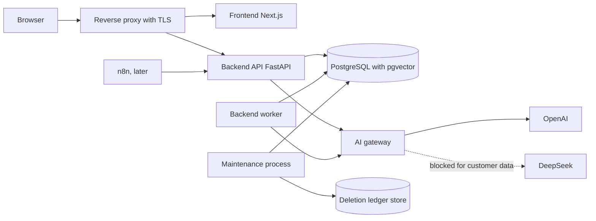

# TAD.md: Technical Architecture Document

Status: Draft v0.2 (Phase 0.4), pending review. Replaces the earlier TAD draft, which predates the URD, the market addendum and the decision addendum.
Depends on: PRD.md v0.3, SRS.md v0.1, DATABASE.md v0.2 (after the 0.2b patch).
Related: API.md, SECURITY.md, PRIVACY.md, AI_ARCHITECTURE.md, MEMORY_ENGINE.md, TESTING.md, DEPLOYMENT.md, ARCHITECTURE_DECISIONS/.

Items marked **Proposed** are design choices awaiting approval. Items marked **Open** are not decided. Nothing in this document is a legal conclusion.

## 1. Purpose and scope

This document describes how REIA is built: the runtime structure, module boundaries, data access and tenant isolation mechanics, background processing, the AI layer, the memory update and retrieval algorithms, the frontend, privacy mechanics, error handling, configuration, deployment and quality gates. It implements the requirements in SRS.md and the data model in DATABASE.md.

## 2. Architecture principles

1. **Modular monolith.** One deployable backend codebase with strict module boundaries. No microservices until measured needs justify them.
2. **PostgreSQL is the source of truth.** Embeddings are derived and rebuildable (ADR-001, ADR-007).
3. **One door for AI.** All AI calls pass through a single gateway that enforces the provider policy, logging, cost limits and output validation (ADR-010, ADR-017).
4. **Fail closed.** Missing tenant context returns nothing. Missing policy approval blocks the call.
5. **Evidence before assertion.** AI output is accepted only if it validates against a schema and its evidence can be verified against stored source text.
6. **No hidden autonomy.** There is no code path that contacts a customer.
7. **Least privilege.** Separate database roles for migration, application and maintenance. The application role cannot delete.
8. **Hosting neutrality.** Nothing in the design assumes a hosting region or vendor (PRD A5).
9. **Few dependencies.** Each dependency has a stated purpose (section 4.3).
10. **Business logic in the backend.** The frontend and n8n never contain business rules.

## 3. System context and runtime containers



| Container | Role | Database role |
|---|---|---|
| `proxy` | TLS termination, routing `/` to the frontend and `/api/` to the backend, coarse rate limits, security headers | none |
| `frontend` | Next.js application (UI only) | none |
| `api` | FastAPI application: authentication, authorization, request handling | `reia_app` |
| `worker` | Same codebase, different entrypoint. Claims and runs background jobs | `reia_app` (plus the claim function, section 9.2) |
| `maintenance` | Same codebase. Scheduled retention, deletion, purge and ledger export jobs | `reia_maintenance` |
| `db` | PostgreSQL with `pgvector`, `citext`, `pg_trgm`, `unaccent` | n/a |
| `migrate` | One-shot job run by the deployment pipeline | `reia_migrator` |
| `n8n` (later) | Selected integration workflows, separate network, scoped API credential | none |

The `api`, `worker` and `maintenance` containers run the same image. They differ only by entrypoint and credentials.

## 4. Technology stack

### 4.1 Confirmed stack (from the URD)

Backend: Python, FastAPI, Pydantic, SQLAlchemy, Alembic. Database: PostgreSQL with pgvector. Frontend: Next.js, React, TypeScript, Tailwind CSS. AI: OpenAI and DeepSeek behind a provider abstraction. Infrastructure: Docker, Docker Compose, Git, GitHub. Automation: n8n.

### 4.2 Refinements proposed here

| Topic | Proposal | Reason |
|---|---|---|
| SQLAlchemy mode | SQLAlchemy 2.0 async API with the psycopg 3 driver (ADR-016) | The backend is I/O-heavy (database and provider calls). One consistent async style avoids mixing thread pools and event loops |
| Migrations | Alembic, run with the migrator role over a synchronous connection | Migrations are sequential and run outside the request path |
| Background jobs | Database-backed queue in `processing_jobs`, claimed with `FOR UPDATE SKIP LOCKED`, run by a separate worker process (ADR-015) | `BackgroundTasks` are lost on restart and give no retry or visibility. This supersedes the earlier draft |
| Scheduler | A small loop inside the `maintenance` entrypoint, no extra dependency (ADR-020) | Deletion and retention are security-sensitive and stay out of n8n |
| Frontend data layer | TanStack Query | Caching, retries and loading states |
| Component library | shadcn/ui on Radix primitives, with Tailwind | Accessible components that are copied into the repo, so there is no runtime library lock-in |
| Frontend i18n | `next-intl` with locale resources for `en`, `es`, `pt` | Decided in the 0.1 review |
| Forms | React Hook Form with Zod | Typed validation |
| API types | Generate the TypeScript client types from the backend OpenAPI schema | One source of truth for request and response shapes |

### 4.3 Dependency register (backend)

| Package | Purpose |
|---|---|
| `fastapi`, `uvicorn` | HTTP framework and server |
| `pydantic`, `pydantic-settings` | Validation, typed configuration |
| `sqlalchemy`, `alembic`, `psycopg` | ORM, migrations, driver |
| `pgvector` | Vector type support for SQLAlchemy |
| `httpx` | Outbound HTTP |
| `openai` | OpenAI SDK, used only inside `ai/providers/openai.py` |
| `argon2-cffi` | Password hashing (SR-AUTH-002) |
| `pyjwt` | Access tokens |
| `cryptography` | Authenticated encryption for stored integration credentials |
| `phonenumbers` | E.164 normalization (SR-CUST-003) |
| `python-multipart` | File uploads |
| `pyyaml` | Country configuration files |
| Language detection library | Local detection (SR-CONV-007). **Open:** candidate `lingua-language-detector`, final choice in Phase 4 after testing on short chat-style messages |

Development and test: `pytest`, `pytest-asyncio`, `ruff`, `mypy`, `import-linter`, `pip-audit`. Dependencies are pinned with a lock file, and a new dependency needs a one-line justification in the pull request.

## 5. Repository and backend structure

This matches the skeleton created in Phase 0. Files marked "add" are not in the skeleton yet.

```text
backend/
  app/
    main.py                  application factory, middleware, router mounting
    core/
      config.py              typed settings
      security.py            hashing, JWT, encryption helpers
      logging.py             JSON logging, request context
      exceptions.py          domain errors and HTTP mapping
      i18n.py                locale helpers
      permissions.py         (add) permission matrix as code
      context.py             (add) RequestContext: user, organization, role, request id
      ratelimit.py           (add) RateLimiter interface and in-memory implementation
    api/
      router.py              mounts module routers under /api/v1
      dependencies.py        authentication, organization context, database session
    database/
      base.py, session.py    engine, session factory, tenant-aware transaction helper
      models/                all ORM models
      repositories/          shared BaseRepository classes
    modules/
      authentication/ organizations/ users/ customers/ conversations/
      intelligence/ memory/ assistant/ followups/ call_briefings/
      tasks/ integrations/ analytics/
        router.py service.py repository.py schemas.py
    ai/
      gateway.py             (add) the single entry point for AI calls
      provider_policy.py     (add) restricted providers and policy decisions
      providers/             base.py, openai.py, deepseek.py, fake.py
      prompts/               versioned prompt files and registry
      extraction/ retrieval/ evaluation/
    workers/
      main.py                (add) worker entrypoint
      maintenance.py         (add) maintenance entrypoint and scheduler
      handlers/              (add) one handler per job type
    config/countries/        ae.yaml es.yaml pt.yaml
    locales/                 en.json es.json pt.json
  alembic/versions/
  tests/ unit/ integration/ security/ evaluation/
frontend/                    see section 13
workflows/n8n/               exported workflows (later)
infrastructure/              Dockerfiles, compose files, proxy configuration
docs/
scripts/
```

### 5.1 Layering and dependency rules

| Layer | May call | Must not |
|---|---|---|
| `api` (routers) | its module's service, schemas | database, repositories, AI providers |
| `modules/*/service.py` | its own repository, other modules' **services**, the AI gateway | other modules' repositories, provider SDKs |
| `modules/*/repository.py` | database session, models | services, AI |
| `ai/*` | its own packages | `modules`, `api` (it receives plain inputs and returns typed results) |
| `workers/*` | services, gateway | routers |

Rules are enforced by `import-linter` contracts in CI: layering, no cross-module repository imports, and provider SDKs imported only inside `ai/providers/`. A contract failure fails the build.

## 6. Request lifecycle and transactions

1. The proxy forwards the request. Middleware assigns a request id, starts structured logging, applies security headers and the CORS allowlist, and applies the rate limiter.
2. `api/dependencies.py` authenticates the access token, loads the membership and role from the database and builds a `RequestContext` (section 7.2).
3. The database dependency opens one transaction and runs `SELECT set_config('app.current_org_id', :org_id, true)`. The setting is transaction-local, so it is safe with pooled connections.
4. The router validates input through Pydantic schemas and calls the service. The service checks permissions, runs business logic and calls repositories. Every repository query also filters by `organization_id` explicitly (defense in depth with RLS).
5. On success the transaction commits. On an exception it rolls back and the error handler returns the error envelope (section 15).

**Rule: no database transaction is held open during a provider call.** A request or job that needs AI follows three steps: read the needed context (short transaction), call the gateway (no transaction), write the results (short transaction). This prevents long transactions and lock pile-ups when a provider is slow.

## 7. Authentication and authorization

### 7.1 Tokens

- **Access token:** a short-lived JWT carrying the user id (`sub`) and the selected organization id (`org`). It is returned in the response body and kept in memory by the frontend. Role and membership are **not** trusted from the token. They are loaded from the database on every request, so removing a member or changing a role takes effect immediately (SR-ORG-005).
- **Refresh token:** an opaque random value, stored as a hash in `refresh_tokens` with a family id. It is rotated on every use. Reuse of a rotated token revokes the family and writes an audit entry (SR-AUTH-005). It is delivered in a cookie with `HttpOnly`, `Secure`, `SameSite=Strict` and a path limited to the auth endpoints (ADR-018).
- Switching organization issues a new access token after a membership check.
- Token signing keys come from configuration and support rotation through a key id header.

### 7.2 Request context

`RequestContext` carries: user id, organization id, role, request id, locale, timezone and client IP. It is immutable and created once per request. Services receive it explicitly. They never read global state.

### 7.3 Authorization

`core/permissions.py` encodes the matrix in SRS section 3 as code: a `Permission` enum, a role-to-permissions mapping and a function `can(context, permission, resource)`. For customer-scoped permissions the function also applies the visibility rule: owners and admins see all customers, agents and read-only members see assigned customers only. Authorization is checked in the service layer, not in routers, so workers and API paths share one implementation. A test enumerates every route and fails if a route has no declared permission.

### 7.4 CSRF and cookies

Only the refresh and logout endpoints use the cookie. They are protected by `SameSite=Strict`, an `Origin` header check and a required custom header. All other endpoints use the bearer access token, which a browser does not attach automatically.

### 7.5 Passwords and one-time tokens

Passwords use Argon2id. Email verification, password reset and invitation tokens are random, single-use, expiring and stored as hashes. Password reset revokes all refresh tokens of the user. The responses of reset and login never reveal whether an email exists.

## 8. Data access and tenant isolation

### 8.1 Roles

As in DATABASE.md section 4.1: `reia_migrator`, `reia_app`, `reia_maintenance`. Connection strings are separate settings, and each container receives only its own.

### 8.2 Tenant-aware session

`database/session.py` exposes one helper, `tenant_session(org_id)`, which opens the transaction and sets `app.current_org_id`. Repositories take a session from this helper only. A repository base class requires a `RequestContext` and adds the explicit `organization_id` filter. A lint rule in the architecture tests rejects raw `text()` SQL outside the repositories and migrations.

### 8.3 Testing RLS correctly

Superusers and table owners bypass Row-Level Security. Isolation tests therefore **must run as `reia_app`**, never as a superuser or the migrator. The test harness creates the roles exactly as production does, and a startup check in integration tests asserts that the connected role has neither `SUPERUSER` nor `BYPASSRLS`.

### 8.4 Concurrency

Writes that depend on the current state of a customer's facts take a transaction-scoped advisory lock keyed on the customer id. This serializes two conversations of the same customer, so two current facts for one slot can never be created. The partial unique index remains the final guard. If it fires, the job retries.

### 8.5 Connection pooling

The application pool is sized per container. If an external pooler is added, it must use transaction pooling only, which is compatible with transaction-local `set_config`. Session pooling with session-level settings is not allowed.

## 9. Background processing

### 9.1 Queue design (ADR-015)

`processing_jobs` is the queue. A job has a type, a subject, an idempotency key, attempts and a status. The worker loop:
1. Claim one job through the claim function (below).
2. Set the tenant context for the job's organization.
3. Run the handler (read, call gateway, write, as in section 6).
4. Mark the job `succeeded`, or `failed` with a retry time, or `dead` when attempts are exhausted.

The worker polls with a short interval. `LISTEN/NOTIFY` may be added later as an optimization. It is not required.

### 9.2 Claiming across tenants (finding)

`processing_jobs` has Row-Level Security like every tenant table, so a worker without an organization context cannot see any job. Claiming must be cross-tenant, but only for scheduling data. The design uses a `SECURITY DEFINER` function owned by `reia_migrator`:

`claim_next_job(worker_id text, lease_seconds int)` selects the next due job with `FOR UPDATE SKIP LOCKED`, marks it `running` with a lease, and returns only the job id, organization id, type and subject id. `EXECUTE` is granted to `reia_app` only. After the claim, the worker sets the organization context, and everything else runs under RLS. This needs `locked_by`, `locked_at` and `next_attempt_at` on `processing_jobs` (section 24).

### 9.3 Retries, leases and dead jobs

- Transient failures retry with exponential backoff and jitter up to `max_attempts`.
- A job whose lease expired is returned to the queue by the claim function (stuck-job recovery).
- A job that exhausts its attempts becomes `dead`. The conversation shows `failed` with a safe reason, and owners and admins are notified.
- Handlers are idempotent: they check the job's idempotency key and the current state of the subject before writing (section 11).

### 9.4 Job types

`process_conversation`, `embed`, `re_embed`, `reprocess`, `export`, `sync` (deferred). Maintenance work (retention, erasure, purges, ledger export) is **not** in this queue. It runs in the maintenance process.

### 9.5 Maintenance process (ADR-020)

A separate container with its own credentials and a configuration-driven schedule. Its tasks:
- Execute pending erasures through `erase_customer` and `erase_workspace`, in order of the deletion ledger.
- Export new ledger entries to the separate ledger store (section 14.3).
- Run `purge_expired_audit_logs` and `purge_expired_tokens`.
- Delete embeddings of rejected facts and orphaned embeddings.
- Detect dormant workspaces and notify owners.
- Verify that backups older than the backup retention window are gone (reports only, since backup storage is operated outside the database).

n8n is not used for any of this. It may later trigger notifications or integration flows, but never deletion.

## 10. AI architecture

### 10.1 The AI gateway (ADR-017)

`ai/gateway.py` is the only code that business modules call for AI. For each request it:
1. Requires a typed request that includes the **task**, the **data class** (no default value, so omitting it is a type error), the organization context and the output schema.
2. Resolves provider and model from `organization_provider_settings`, with defaults from deployment configuration.
3. Runs the provider policy check (10.3). A blocked request makes no outbound call, is recorded as `blocked_by_policy` and raises a policy error.
4. Checks the organization's usage and cost limits.
5. Calls the provider with a timeout and bounded retries.
6. Validates the output against the Pydantic schema. One retry with the validation error on failure, then a failure.
7. Writes the `ai_runs` row: provider, model, endpoint, data class, prompt name and version, input hash, tokens, cost, latency and status. No raw prompt or response by default.

An architecture test fails if any module other than `ai/providers/*` imports a provider SDK, or if any module other than the gateway instantiates a provider.

### 10.2 Provider interface

```text
LLMProvider
  generate_structured(request) -> StructuredResult[T]
  embed(request)               -> EmbedResult
```

Adapters: `OpenAIProvider`, `DeepSeekProvider`, `FakeProvider` (deterministic, for tests and offline development). Providers declare their capabilities (native structured output, maximum context, embedding support). When a provider lacks native schema enforcement, the adapter uses JSON mode and the gateway validation is the only guarantee. Adding a provider needs only a new adapter and a configuration entry. Region-specific providers can be added the same way.

The chat model per task is configuration, not code. The concrete model choice is made in Phase 5 from the evaluation results. The embedding model is fixed by ADR-007.
### 10.3 Provider policy (ADR-010)

`ai/provider_policy.py` holds the restricted-provider list (currently DeepSeek) and one function `decide(provider, task, data_class, org_settings, deployment_config)`:
- Data classes: `public`, `synthetic`, `anonymized`, `pseudonymized`, `identifiable`.
- `pseudonymized` is mapped to `identifiable` before the decision.
- Restricted providers are **denied** for `identifiable` unless code, deployment and organization settings all allow it.
- Organization settings can only narrow what code and deployment allow.

Three independent enforcement points:
1. **Code:** the policy function inside the gateway.
2. **Deployment:** in production, the restricted provider's credentials are not provisioned, and `AI_RESTRICTED_PROVIDERS_ALLOWED_FOR_CUSTOMER_DATA` is empty. The application refuses to start if configuration contradicts the policy (SR-PROV-006).
3. **Database:** `organization_provider_settings` per organization and task.

The fallback logic obeys the same policy: a fallback provider must itself be allowed for the request's data class.

### 10.4 Data minimization in prompts

A `ContextBuilder` assembles each prompt from explicit fields. It excludes contact identifiers and other personal fields that the task does not need. It does not claim to anonymize: whatever it sends about a real customer is still classified `identifiable`.

### 10.5 Prompts and structured outputs

Prompts live as versioned files in `ai/prompts/` with a registry that exposes name, version and content hash. Each `ai_runs` row stores the name and version. Customer text is placed in a clearly delimited data section, and the system instructions state that it is data, not instructions (SR-INTEL-018). Output schemas are strict Pydantic models. Unknown fields are rejected.

### 10.6 Long conversations

Conversations larger than the model's context budget are split into ordered chunks of whole messages with a small overlap. Extraction runs per chunk. Results are merged in message order by the memory update algorithm. Evidence verification runs against the source message of each fact. Chunk sizes are set in AI_ARCHITECTURE.md.

### 10.7 Cost control

The gateway reads prices from a configuration file (`ai/pricing.yaml`) that must be verified against the provider's current price list before production. It records cost per call and enforces per-organization limits (SR-PROV-012).

## 11. Conversation processing and memory update

### 11.1 Import path (synchronous part)

1. Validate size, encoding and type (SR-CONV-002). Uploaded files are parsed in memory and **not stored**. Only the decoded text is stored.
2. Normalize for hashing and compute `content_hash`. If it already exists in the organization, return the existing conversation (SR-CONV-005).
3. Detect language. Parse messages.
4. Store `conversations` and `conversation_messages` in one transaction. Link to the customer or set `pending_customer_match`.
5. If linked, insert a `process_conversation` job with idempotency key `conversation_id:pipeline_version`.

### 11.2 Processing path (worker)

1. **Read** (transaction 1): conversation, messages, customer's current and disputed facts, open commitments.
2. **Extract** (no transaction): gateway call per chunk.
3. **Verify:** schema valid, fact key in registry, every evidence quote found in its source message (SR-INTEL-007), money facts have a stated currency (SR-INTEL-009). Rejected items are logged with a reason code and no content.
4. **Write** (transaction 2): take the customer advisory lock, re-check the conversation status and the job key, apply the memory update algorithm (11.3), write events, write the summary, set the conversation `processed`, mark the job done, insert the `embed` job. All in one commit.
5. On failure before step 4, nothing is written and the job retries or ends `dead`.

### 11.3 Memory update algorithm

Facts are processed in message order. For each verified extracted fact with key K and slot S:

| Situation | Action |
|---|---|
| No current fact for (K, S) | Insert as `current` |
| A current fact exists, same value | No new current fact (OPEN-S2: corroboration) |
| Different value, existing current fact is `verified` | Insert the new fact as `disputed`, mark the existing one `disputed`? **No.** Keep the verified fact `current`, insert the new fact as `disputed`, and create an open conflict (SR-MEM-008) |
| Different value, change signal `explicit_replacement` | Old fact `superseded` with `valid_to` set. New fact `current` with `supersedes_fact_id`. Memory event created |
| Different value, any other change signal | Both facts `disputed`. Open conflict created |
| New fact's `valid_from` is older than the current fact's | Insert as `superseded` (historical). Current fact unchanged (SR-MEM-006) |
| Multi-valued key, change signal `addition` | Insert in a new slot as `current` |

Every change writes a `customer_memory_events` row. The algorithm is a pure function over (existing facts, new fact) that returns a list of actions. The service applies the actions. This makes the rules unit-testable without a database, and the evaluation set covers each row of the table.

## 12. Retrieval and assistant architecture

### 12.1 Hybrid retrieval

`RetrievalService.retrieve(context, customer_id, query, filters)`:
1. **Structured:** current and disputed facts, recent events and open commitments for the customer. This set is small and is included as profile context.
2. **Keyword:** `websearch_to_tsquery` over `conversation_messages.search_vector`, using the text search configuration chosen from the query language.
3. **Vector:** embed the query through the gateway (data class `identifiable`, policy checked), then nearest neighbors in `memory_embeddings`, filtered by organization, customer, active model and version, with the literal predicate that matches the partial index (DATABASE.md 6.1).
4. **Fusion:** reciprocal rank fusion of keyword and vector lists, then boosts for verification status, temporal validity, recency and source quality, and a query-intent adjustment. Weights are configuration and are tuned against the evaluation set in Phase 6.
5. Return items with type, id, date, language, lifecycle and verification status (SR-MEM-020).

Rejected facts and archived customers are excluded in every step.

### 12.2 Assistant

1. Validate access to the customer (permission matrix, visibility rule).
2. Retrieve (12.1).
3. Build a grounded context in which every item has a stable reference label.
4. Gateway call with a structured answer schema: claims, each with source references and dates, plus `missing_information`, `uncertainties` and `suggestions`.
5. **Validate references:** each id must exist, belong to the same customer and organization and not be rejected. Remove invalid claims (SR-ASST-003).
6. If no supported claim remains, return the standard "information not available" answer, which needs no model call (SR-ASST-004).
7. Return the answer in the user's UI language, with evidence quotes in their original language.

Drafts and briefings use the same retrieval and validation pattern with their own output schemas. Drafts and briefings store the references they used.

## 13. Frontend architecture

```text
frontend/src/
  app/                 routes (App Router), layouts, locale segment
  components/ui/       shadcn/ui primitives
  components/layout/   shell, navigation
  features/            authentication, customers, conversations, memory,
                       assistant, followups, call-briefings, tasks, dashboard
  hooks/ services/ lib/ types/ styles/
```

- **API client:** one typed client generated from the backend OpenAPI schema. Components do not call `fetch` directly.
- **Auth:** the access token is held in memory. A refresh flow uses the cookie. Protected routes redirect unauthenticated users. The frontend never holds provider keys and never calls AI providers.
- **Same origin:** the proxy serves the frontend and the API under one origin, so the cookie is same-site and no wide CORS rule is needed.
- **i18n:** `next-intl`, locales `en`, `es`, `pt`, English fallback. UI language is a user setting. Dates, numbers and currencies are formatted by locale and the organization timezone.
- **RTL readiness:** logical CSS properties (`margin-inline-start`, `padding-inline`, and so on), no hardcoded left or right, and a `dir` attribute driven by the locale. No Arabic UI at launch (ADR-013).
- **Accessibility:** target WCAG 2.2 AA. Keyboard navigation, focus management, labelled controls, loading, error and empty states, and confirmation for sensitive actions.
- **AI output display:** every AI statement shows its status (current, historical, disputed, unverified) and a link to its source. Original language text is shown with an optional translation.
- **Content safety:** all imported text is rendered as text and never as HTML.

## 14. Privacy mechanics

### 14.1 Logging

Logs are structured JSON with request id, organization id, user id and route. A scrubbing filter drops any field named like content, body, message, email or phone. Tests check that representative log output never contains message text or contact details (SR-PRIV-011).

### 14.2 Retention and deletion jobs

Implemented in the maintenance process (9.5) with the proposed defaults from PRD 8.4. Retention is configurable per organization through validated settings. The proposed values are not legally verified.

### 14.3 Deletion ledger and its separate store (ADR-019, Proposed)

- Every verified deletion request is written to `deletion_ledger` before anything is deleted.
- The maintenance process exports each new ledger entry, as an immutable object, to a separate store that is not part of the database backups. **Proposed:** S3-compatible object storage with object lock (write-once) in its own account or project with its own credentials. Hosting vendor and region are Open (A5).
- Ledger rows carry an `exported_at` marker, so the export is an outbox: an entry counts as durable only once exported (section 24).
- Entries contain identifiers and timestamps only, never personal data.

### 14.4 Backups and restore

- Backup retention is at most 35 days (the proposed default), so a backup taken before a deletion expires within 35 days after it.
- Backups are encrypted and restored only into an isolated environment first.
- **Restore procedure** (full runbook in DEPLOYMENT.md, tested in Phase 12): restore to isolation, read the ledger from the separate store, re-apply every entry executed after the snapshot time and every entry still pending, verify with a query that none of those subjects exists, then open the system to users. Opening without the verification step is not allowed.

### 14.5 Subject export

Exports are produced as background jobs of type `export`. An export artifact contains personal data, so it is encrypted, stored with a short expiry and deleted by the maintenance process. The storage for artifacts is Open (section 25).

## 15. Error handling

### 15.1 Domain errors

| Error | HTTP | Notes |
|---|---|---|
| `ValidationError` | 422 | Field-level details, no echo of sensitive values |
| `AuthenticationError` | 401 | Generic message |
| `PermissionDeniedError` | 403 | |
| `NotFoundError` | 404 | Also used for resources in another tenant, so existence is not revealed |
| `ConflictError` | 409 | Duplicate identifier, duplicate import, state conflict. Carries the existing resource reference when permitted |
| `RateLimitError` | 429 | With a retry hint |
| `PolicyBlockedError` | 403 | AI provider policy blocked the request |
| `ProviderUnavailableError` | 503 | After bounded retries |
| `OutputInvalidError` | 502 | Model output failed validation after the retry |
| `InternalError` | 500 | Generic message, details only in logs |

The envelope is `{ "error": { "code", "message", "details", "request_id" } }` (SR-SYS-009). Messages are localizable. Codes are stable.


### 15.2 Retry policy

| Failure | Behavior |
|---|---|
| Provider timeout, 429, 5xx | Exponential backoff with jitter, bounded attempts, then `ProviderUnavailableError` or a failed job |
| Schema-invalid output | One retry with the validation error, then fail |
| Policy block, authentication error, validation error | No retry |
| Serialization or unique-index conflict in the write step | Retry the write transaction |

## 16. Configuration and secrets

All settings are typed (`pydantic-settings`) and read from environment variables. The application refuses to start on invalid or missing required settings, or on an unsafe combination such as `ENVIRONMENT=production` with debug enabled.

| Group | Settings (names) |
|---|---|
| Core | `ENVIRONMENT`, `LOG_LEVEL`, `CORS_ALLOWED_ORIGINS`, `PUBLIC_BASE_URL` |
| Database | `DATABASE_URL` (app role), `DATABASE_URL_MIGRATOR`, `DATABASE_URL_MAINTENANCE` |
| Auth | `JWT_SIGNING_KEYS` (with key ids), `ACCESS_TOKEN_TTL_SECONDS`, `REFRESH_TOKEN_TTL_SECONDS` |
| Encryption | `CREDENTIAL_ENCRYPTION_KEYS` (with key ids) |
| AI | `OPENAI_API_KEY`, `DEEPSEEK_API_KEY` (absent in production unless approved), `AI_RESTRICTED_PROVIDERS_ALLOWED_FOR_CUSTOMER_DATA` (empty by default), `AI_DEFAULT_PROVIDER_*` per task |
| Embeddings | `EMBEDDING_PROVIDER`, `EMBEDDING_MODEL`, `EMBEDDING_DIMENSION`, `EMBEDDING_MODEL_VERSION` |
| Email | `EMAIL_PROVIDER` and its credentials |
| Ledger store | `LEDGER_STORE_URL`, `LEDGER_STORE_CREDENTIALS` |
| Limits | see section 21 |

`.env.example` lists the names without values. `.env` is git-ignored. Production secrets come from the platform's secret manager. A CI secret scan blocks commits that contain keys. Secrets never reach the frontend. Only variables prefixed for public use are exposed to it, and none of them is a secret.

Integration credentials stored in the database (`integrations.credentials_encrypted`) use authenticated encryption with a key id, so keys can be rotated.

## 17. Observability and health

- `/healthz`: process is alive.
- `/readyz`: database reachable, migrations at head, active embedding index present, provider policy configuration valid.
- Structured logs with request id, correlation to job id and `ai_runs` id.
- Metrics: request latency and error rates, job queue depth and age, job failures, provider latency, tokens and cost, policy blocks. Exposure format is decided with the hosting choice.
- Error tracking is **Open**: a third-party service would receive error data, so its choice needs the privacy review and a scrubbing configuration.
- Alerts: dead jobs, queue age, provider error rate, ledger export lag, backup failure.

## 18. Deployment and environments

| Environment | Purpose | Notes |
|---|---|---|
| Local | Development | Docker Compose with `db`, `api`, `worker`, `maintenance`, `frontend`, `proxy`. Fake provider by default. Synthetic data only |
| CI | Automated checks | Ephemeral Postgres with pgvector, roles created as in production |
| Staging | Pre-production checks | Synthetic data only. Restricted providers never provisioned |
| Production | Pilot | Hosting vendor and region **Open** (A5). Managed PostgreSQL must support `pgvector`, which must be confirmed for the chosen provider |

Containers run as non-root with minimal base images. Images are built in CI and scanned. Database migrations run as a separate step before the new application version starts. There is no manual schema change on any shared database.

## 19. Quality gates and testing architecture

CI runs on every pull request: lint (`ruff`), types (`mypy`), architecture contracts (`import-linter`), unit tests, integration tests, migration tests, security tests, dependency audit (`pip-audit`) and secret scan. TESTING.md has the full plan. The architectural parts are:

- **Real Postgres in tests**, with pgvector, running the real migrations and the real roles. No SQLite substitution.
- **RLS tests as `reia_app`**, including "no context returns nothing", cross-tenant reads and writes, and composite foreign key rejection.
- **Privilege tests:** `UPDATE original_content` denied, `DELETE` denied for the application role.
- **FakeProvider** for deterministic AI tests, and a fixed evaluation dataset in English, Spanish and Portuguese run by a separate harness.
- **Pure-function tests** for the memory update table and ranking.
- **Policy tests:** restricted provider blocked for every task, including embeddings, with `pseudonymized` treated as `identifiable`.
- **Restore test:** deletion ledger re-apply after a restore.
- **Architecture tests:** provider isolation and route-permission coverage.

## 20. Performance and scalability

- Indexes follow DATABASE.md. Lists use cursor pagination. N+1 queries are avoided through explicit loading strategies, and a test counts queries on key endpoints.
- AI work is asynchronous (jobs) except interactive assistant, draft and briefing requests, which have their own latency budget (SR-NFR-002).
- The proposed latency targets in SR-NFR-001 are measured under the load model defined in TESTING.md.
- Scale-out path, in this order and only when measurements justify it: more `api` and `worker` replicas (they are stateless), a shared rate limiter, a database connection pooler (transaction mode), read replicas for search, and only then any service extraction.

## 21. Proposed starting limits (resolves SRS OPEN-S9 as proposals)

These are starting values that are configurable and are tuned in Phase 12. They are not validated.

| Setting | Proposed value |
|---|---|
| Access token lifetime | 15 minutes |
| Refresh token lifetime | 14 days, rotated on use |
| Email verification and invitation tokens | 24 hours and 7 days |
| Password reset token | 1 hour |
| Login throttle | 5 failed attempts per 15 minutes per account and per IP, then increasing delay |
| Maximum import size | 5 MB of text per import |
| Page size | 25 default, 100 maximum |
| Interactive AI requests | 20 per user per minute |
| Provider timeout and retries | 60 seconds, 2 retries |
| Job maximum attempts | 3 (as in DATABASE.md) |
| Job lease | 10 minutes |
| Worker poll interval | 2 seconds |
| Backup retention | at most 35 days |

**Rate limiter (Open):** the MVP uses an in-process limiter behind the `RateLimiter` interface plus coarse limits at the proxy. This is correct only for a single `api` instance. Before running more than one instance, a shared implementation is required. Redis is not introduced now because it adds a dependency and a data store.

## 22. Technical risks

| ID | Risk | Mitigation |
|---|---|---|
| T1 | LLM output quality varies by language | Strict schemas, evidence verification, multilingual evaluation set, model choice by measurement in Phase 5 |
| T2 | RLS bypassed by a privileged connection | Dedicated roles, role checks in tests, startup check on role attributes |
| T3 | Embedding index not used by the planner, slow retrieval | Literal predicates from the allowlist, EXPLAIN tests, startup index check |
| T4 | Restored backup resurrects deleted data | Deletion ledger, separate durable store, mandatory re-apply and verification step, restore test |
| T5 | Long conversations exceed model context | Chunking and ordered merge |
| T6 | Provider outage or price change | Gateway retries, provider abstraction, configurable pricing, cost limits |
| T7 | Worker crash mid-job | Leases, idempotent handlers, advisory lock, unique indexes |
| T8 | Prompt injection through imported text | Data delimiting, typed output only, no tool execution, reference validation, tests |
| T9 | Hosting lacks `pgvector` or EU or UAE region options | Confirm before choosing hosting; keep the vector layer rebuildable |
| T10 | Third-party services (error tracking, email) receive personal data | Privacy review before choosing, scrubbing, data processing agreements |
| T11 | Single-instance limiter bypassed when scaling out | Shared limiter required before more than one `api` instance |

## 23. Architecture decisions introduced here

| ID | Decision | Status |
|---|---|---|
| ADR-015 | Database-backed job queue with a separate worker process and a `SECURITY DEFINER` claim function, replacing `BackgroundTasks` | Proposed |
| ADR-016 | SQLAlchemy 2.0 async with psycopg 3 | Proposed |
| ADR-017 | A single AI gateway; provider SDKs isolated in `ai/providers/`; contracts enforced by `import-linter` | Proposed |
| ADR-018 | Access token in memory, refresh token in an `HttpOnly` `SameSite=Strict` cookie, one origin through the proxy; membership and role loaded from the database on every request | Proposed |
| ADR-019 | Deletion ledger exported to a separate write-once store (S3-compatible object lock proposed); vendor and region open | Proposed |
| ADR-020 | Retention, deletion and purge jobs run in a separate maintenance process, not in n8n | Proposed |
| ADR-021 | No database transaction is held open during provider calls | Proposed |

These are added to `docs/ARCHITECTURE_DECISIONS/README.md` in the Phase 0 wrap-up (step 0.9).

## 24. Impact on other documents

### 24.1 DATABASE.md changes required (to be applied as v0.3 before Phase 2 migrations)

| # | Change | Reason |
|---|---|---|
| DB-1 | Add `locked_by`, `locked_at`, `next_attempt_at` to `processing_jobs`. Add the `claim_next_job` function with `EXECUTE` for `reia_app` | Cross-tenant job claiming under RLS (9.2) |
| DB-2 | Add `exported_at` and `export_attempts` to `deletion_ledger` | Outbox for the separate ledger store (14.3) |
| DB-3 | Add a `legal_holds` table | SR-PRIV-009, SRS OPEN-S5 |
| DB-4 | Add `fact_evidence` (corroborating mentions) and `extraction_uncertainties` | SRS OPEN-S2 and OPEN-S3 |
| DB-5 | Add the purpose `org_invitation` to `one_time_tokens`, with an organization and role reference | SR-ORG-003 |
| DB-6 | Add a `data_exports` table (status, expiry, storage reference) and the `export` job type | 14.5 |
| DB-7 | Extend `processing_jobs.job_type` with `re_embed` and `export` | 9.4 |

### 24.2 SRS.md

OPEN-S1 is confirmed (agents and read-only members see assigned customers only). OPEN-S9 is answered with proposals in section 21. The other open items stay open and are tracked in section 25.

## 25. Open items

| ID | Item | Resolve in |
|---|---|---|
| OPEN-T1 | Hosting vendor and region, `pgvector` availability, UAE PDPL transfer analysis | Compliance assessment, before production |
| OPEN-T2 | Language detection library | Phase 4 |
| OPEN-T3 | Storage for export artifacts | DEPLOYMENT.md |
| OPEN-T4 | Email sending service | Before Phase 2 (verification emails) |
| OPEN-T5 | Error tracking vendor and scrubbing | Privacy review |
| OPEN-T6 | Shared rate limiter before multi-instance | Before scaling out |
| OPEN-T7 | Ledger store vendor | DEPLOYMENT.md |
| OPEN-T8 | Chat model per task | Phase 5 evaluation |
| OPEN-T9 | Metrics exposure format | With hosting choice |
| OPEN-T10 | CI platform configuration (GitHub Actions assumed) | Phase 1 |